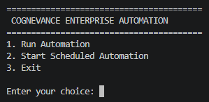
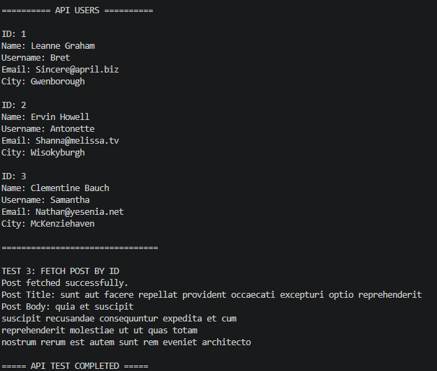
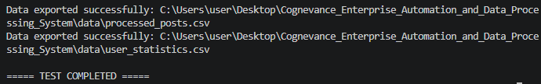
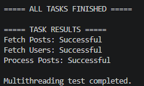
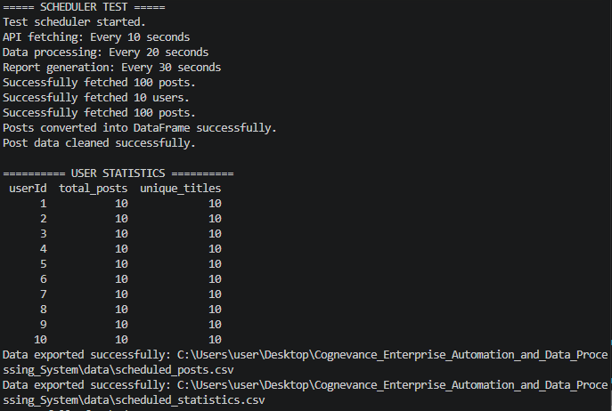
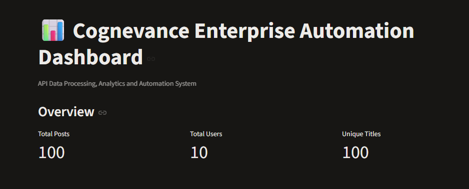
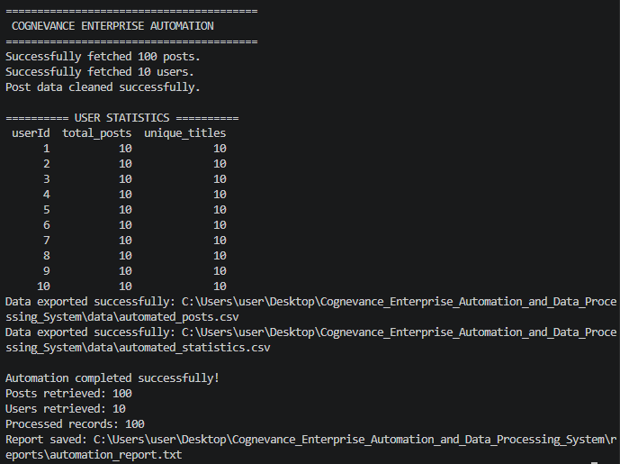

# ⚙️ Cognevance Enterprise Automation & Data Processing System

A Python-based enterprise automation and data processing application designed to retrieve data from external APIs, process and analyze information, execute concurrent tasks, schedule automated operations, and present results through an interactive Streamlit dashboard.

The project integrates Python, REST APIs, Pandas, multithreading, task scheduling, logging, and data visualization into one automation system.

## 🚀 Features

### 1. API Integration
- Fetch posts from external REST APIs.
- Retrieve user information.
- Fetch individual posts using their IDs.
- Process JSON API responses.
- Handle connection errors, timeouts, HTTP errors, and invalid JSON responses.

### 2. Data Processing & Analysis
- Convert API responses into Pandas DataFrames.
- Remove duplicate records.
- Handle missing values.
- Filter records by user ID.
- Search posts using keywords.
- Generate user-wise statistics.
- Export processed data into CSV files.

### 3. Multithreading
- Execute independent tasks concurrently.
- Fetch API data using multiple threads.
- Monitor task execution.
- Measure execution time.
- Handle task failures.

### 4. Task Scheduling
- Schedule recurring API requests.
- Automate data processing.
- Generate periodic reports.
- Maintain execution logs.
- Run scheduled tasks continuously.

### 5. Interactive Dashboard
- Streamlit-based dashboard.
- Display total posts, users, and unique titles.
- View API records in a data table.
- Filter posts by user.
- Search records using keywords.
- Display user-wise statistics.
- Download filtered data as CSV.

### 6. Complete Workflow Automation
- Fetch posts and users concurrently.
- Process and clean API data.
- Generate statistical summaries.
- Export automated CSV files.
- Generate automation reports.
- Maintain application logs.

## 🛠️ Technologies Used

| Technology | Purpose |
|---|---|
| Python | Core programming language |
| REST API | External data retrieval |
| Requests | HTTP requests |
| Pandas | Data processing and analysis |
| Threading | Concurrent task execution |
| Concurrent Futures | Parallel API fetching |
| Schedule | Automated task scheduling |
| Streamlit | Interactive dashboard |
| Matplotlib | Data visualization |
| Logging | Application activity and error logs |
| Git & GitHub | Version control |

## 📂 Project Structure

```text
Cognevance_Enterprise_Automation/
│
├── main.py
├── config.py
├── api_client.py
├── data_processor.py
├── automation.py
├── scheduler.py
├── dashboard.py
│
├── data/
│   ├── automated_posts.csv
│   ├── automated_statistics.csv
│   ├── concurrent_processed_posts.csv
│   ├── concurrent_user_statistics.csv
│   ├── processed_posts.csv
│   ├── scheduled_posts.csv
│   ├── scheduled_statistics.csv
│   └── user_statistics.csv
│
├── logs/
│   ├── automation.log
│   └── scheduler.log
│
├── reports/
│   ├── automation_report.txt
│   └── scheduled_report.txt
│
├── screenshots/
│   ├── api_integration.png
│   ├── automation_workflow.png
│   ├── dashboard.png
│   ├── data_processing.png
│   ├── main_menu.png
│   ├── multithreading.png
│   └── task_scheduling.png
│
├── requirements.txt
├── README.md
└── .gitignore
```

## ⚙️ Installation & Setup

### Step 1: Clone the Repository

```bash
git clone YOUR_GITHUB_REPOSITORY_URL
```

### Step 2: Navigate to the Project Directory

```bash
cd Cognevance_Enterprise_Automation
```

### Step 3: Create a Virtual Environment

```bash
python -m venv venv
```

### Step 4: Activate the Virtual Environment

For Windows PowerShell:

```powershell
venv\Scripts\activate
```

### Step 5: Install Dependencies

```bash
pip install -r requirements.txt
```

### Step 6: Run the Main Application

```bash
python main.py
```

## ▶️ Running the Application

The main application provides the following options:

```text
========================================
 COGNEVANCE ENTERPRISE AUTOMATION
========================================

1. Run Automation
2. Start Scheduled Automation
3. Exit
```

**Option 1: Run Automation**

Executes API fetching, concurrent processing, CSV generation, and report generation.

**Option 2: Start Scheduled Automation**

Starts recurring API fetching, data processing, and report generation.

**Option 3: Exit**

Closes the application.

## 📊 Running the Dashboard

Start the Streamlit dashboard using:

```bash
streamlit run dashboard.py
```

Open the local dashboard in your browser:

```text
http://localhost:8501
```

## 📸 Application Screenshots

### 1. Main Application Menu



### 2. API Integration



### 3. Data Processing



### 4. Multithreading



### 5. Task Scheduling



### 6. Interactive Dashboard



### 7. Complete Automation Workflow



## 📁 Generated Outputs

### CSV Files

The application generates processed data and statistical summaries in the `data/` directory.

Examples:

- `automated_posts.csv`
- `automated_statistics.csv`
- `processed_posts.csv`
- `user_statistics.csv`

### Reports

Automation reports are saved in the `reports/` directory.

- `automation_report.txt`
- `scheduled_report.txt`

### Logs

Application activity and errors are recorded in the `logs/` directory.

- `automation.log`
- `scheduler.log`

## 🔄 Automation Workflow

1. Retrieve posts and users from external APIs.
2. Execute independent API requests concurrently.
3. Convert retrieved JSON data into Pandas DataFrames.
4. Clean and organize the data.
5. Generate user-wise statistics.
6. Export processed information into CSV files.
7. Generate automated reports.
8. Record execution details in log files.
9. Display processed information through the Streamlit dashboard.

## 🎯 Project Objectives

- Develop a practical Python automation application.
- Understand REST API integration.
- Apply data processing techniques using Pandas.
- Implement multithreading and concurrent execution.
- Automate recurring tasks using scheduling.
- Generate reports and CSV outputs.
- Develop an interactive dashboard.
- Apply modular programming and error handling.

## 🔮 Future Enhancements

- Advanced dashboard customization.
- Email notifications for scheduled tasks.
- Database integration.
- Advanced analytics and visualizations.
- Cloud deployment.
- Automated report delivery.
- User authentication and role-based access.

## 📚 Internship Details
Organization: Cognevance Technologies

Domain: Python Programming

Project Level: Level 3 – Advanced

Project Title: Enterprise Automation and Data Processing System

## 👨‍💻 Author
Golla Ramesh Karthik Dheeraj

Python Programming Intern

Cognevance Technologies

## ⭐ If you find this project useful, feel free to explore the repository!